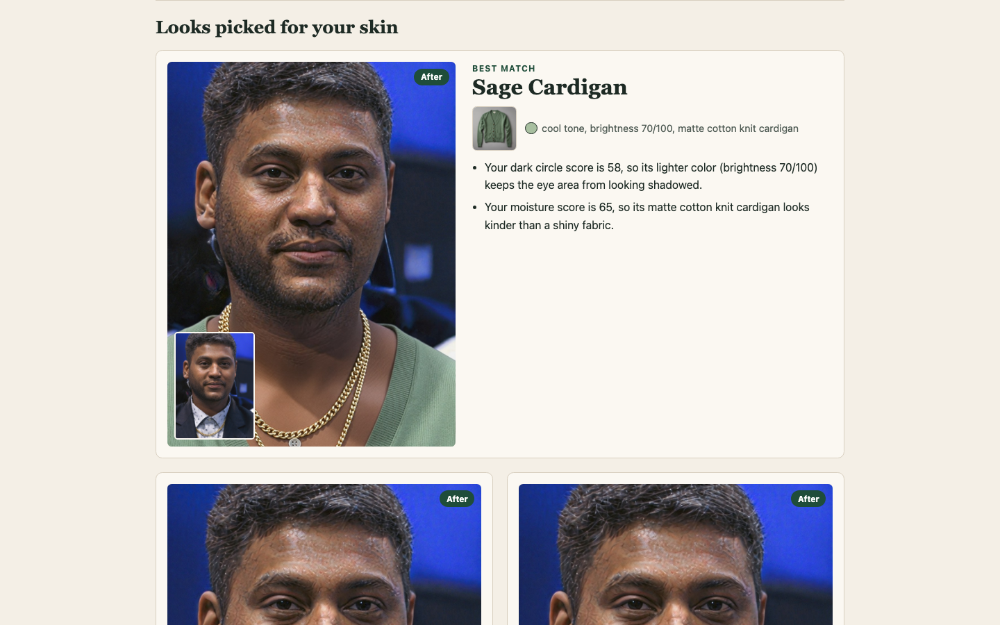

# Skin-Aware Stylist

Hackathon entry for the YouCam API challenge (Skin AI + eCommerce Virtual Try-On).
A face photo goes to **YouCam Skin AI**, which scores radiance, redness, dark circles and moisture.
A rule-based stylist (no runtime LLM, no extra paid key) ranks a small garment catalog by those scores and writes a
"why this fits your skin result" line for each pick; it flags every concern scoring under 80 as an area to care for and quotes that score in the line. **YouCam AI Clothes Virtual Try-On** then renders the top 3 looks on the same photo.

Node >= 20.12, zero npm dependencies.



## Quick start for judges (no key needed)

```
npm start        # http://localhost:8787, demo mode, replays recorded real YouCam responses
node --test      # 60+ tests against a local mock of the YouCam API, no network
```

Pick a sample face, tick the consent box, press "Analyze skin", then "Try on 3 looks". With your own key (below) the same page calls the live YouCam API.
Screenshots: `docs/screenshots/`.

## Run with a key

```
# .env.local (git-ignored, never commit it)
YOUCAM_API_KEY=your-key-here
# optional: YOUCAM_BASE=https://yce-api-01.makeupar.com  UNIT_CAP=800  PORT=8787  LEDGER_PATH=var/units.json
```

```
npm start        # http://localhost:8787, mode "live"
```

The key stays on the server. The **unit guard** (`src/units.js`) wraps every paid call and refuses once
`UNIT_CAP` (default 800 of the 1,000 free units) would be exceeded; the ledger persists in `<repo>/var/units.json` (resolved from the repo root, not the cwd, so the server, scripts and probes share it; override with `LEDGER_PATH`).
Costs, measured live: skin analysis 9 units (4 SD concerns), try-on 2 units each.

`node --env-file=.env.local scripts/live-smoke.js --yes-spend` runs one real skin analysis and one try-on (never run by tests).

## Demo mode (no key)

Without `YOUCAM_API_KEY` the app replays `fixtures/<sampleId>.json` for the bundled sample faces:
`{"skin": <data.results.output of a real skin task>, "tryon": {"<garmentId>": "<base64 image>"}}`.
Missing try-on entries fall back to the sample photo. Uploading your own photo needs a key.

Sample faces and garment images are synthetic; sources and licenses are in [ASSETS.md](ASSETS.md).

Record real fixtures (15 units per new sample; a sample with a stored skin is never re-analyzed, only its missing top-3 try-ons cost 2 each; aborts if the cap would refuse):

```
node --env-file=.env.local scripts/record-fixtures.js --yes-spend
```

## Photo

One photo feeds both skin analysis and try-on. Skin analysis rejects photos where the face is under about 60% of the image width (`error_src_face_too_small`; the task is charged then refunded). Use:

- a close head-and-shoulders portrait, face about 60-80% of the image width, short side at least 480 px, under 8 MB
- even, bright light and a neutral expression
- hair off the forehead
- one person only

The page shows these tips, warns (does not block) on small or oversized files, and repeats them next to a face-too-small error.

## Tests

```
node --test                  # unit + integration, local mock of the YouCam API, no network
node scripts/e2e-mock.js     # scripted end-to-end transcript against the mock
npm run scan                 # secret scan: tracked files and all history (also a CI job)
```

## Privacy notice

- The photo is sent to the Perfect Corp YouCam API only, never to another third-party AI. Perfect Corp keeps the data for up to 30 days.
- You must tick the consent box before upload. Test faces are recommended.
- This app holds images in memory only, never on disk. They are deleted on "Delete my session" or after 10 minutes.
- The API key is server-side only and is not logged.

## AI-assisted development disclosure

Code and tests were written by Claude (Anthropic) working from the entrant's task description. The demo faces are public-domain StyleGAN images (Wikimedia Commons) extended with the YouCam image-extender API, and the garment photos were generated with the YouCam image-generator API (see ASSETS.md). The entrant reviews and selects the work; the stylist is a rule engine, not an LLM.

## License and terms

MIT, see `LICENSE`. Built to follow the Perfect Corp YouCam API terms of service (server-side key, consent before upload, YouCam-only processing, 30-day retention disclosed, images deleted after the session).
